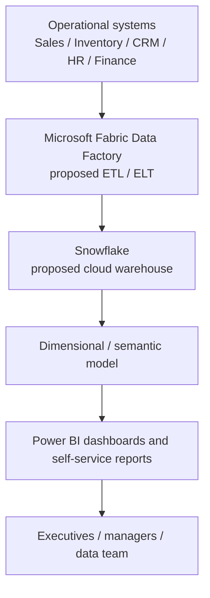
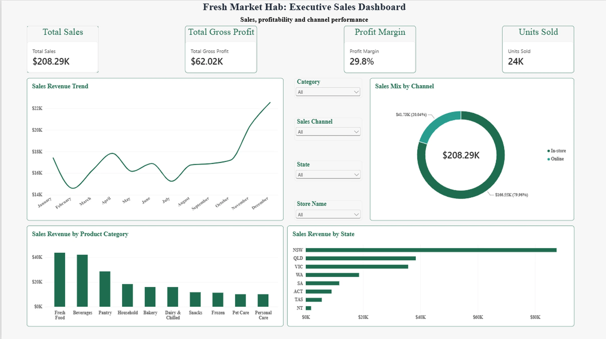
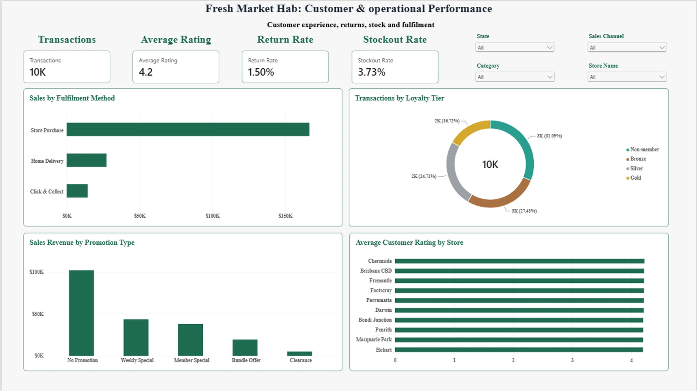
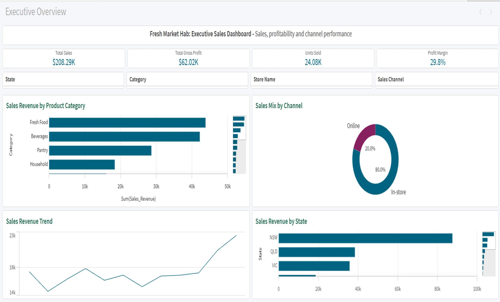

# Case study: Fresh Market Hab BI platform evaluation and prototypes

## Context and objective

Fresh Market Hab (FMH) is an academic retail scenario with operational data separated among sales, inventory, CRM, HR and other systems. Executives and managers need consistent, governed reporting and reduced dependence on ad hoc requests to the data team.

**Objective:** recommend a feasible end-to-end BI approach and demonstrate self-service dashboard reporting using a supplied academic dataset.

## Approach

1. **Define requirements:** functional fit, interoperability, ease of use, performance, security/governance, implementation effort and vendor ecosystem.
2. **Compare alternatives:** assessed Microsoft Fabric Data Factory versus AWS Glue for integration; Snowflake, BigQuery and Redshift Serverless for analytics storage; Power BI, Qlik Sense, Tableau and Looker for dashboards.
3. **Prototype:** developed two Power BI pages (executive performance; customer and operations) and one comparable Qlik Sense overview.
4. **Evaluate:** used a scenario-specific weighted scorecard plus practical experience from the dashboards.
5. **Recommend:** selected Power BI as the reporting platform in a proposed staged rollout, beginning with sales, inventory and CRM.

## Proposed architecture (not implemented)

This architecture was recommended through desk-based analysis. The prototypes were developed using the provided academic dataset; they are **not connected to the proposed Fabric/Snowflake production pipeline**.

## Prototype dashboards

**Power BI executive page:** cards for revenue, gross profit, margin and units; sales trends; category and state performance; channel breakdown; filters for state, store, category and channel.

**Power BI customer/operations page:** transaction count, average rating, return rate and stockout rate; breakdowns for fulfilment method, loyalty tier, promotion and store ratings.

**Qlik Sense executive page:** comparable KPIs and visuals with associative filtering. Selecting NSW in the academic example changed sales from about AUD $208.29K overall to about AUD $87.51K for the selected state.

## Scenario-specific technology scores

| Platform | Weighted score / 5 | Interpretation for FMH |
| --- | ---: | --- |
| Power BI | 4.75 | Recommended for this scenario |
| Tableau | 4.45 | Strong visual and governance capabilities |
| Qlik Sense | 4.25 | Strong associative exploration |
| Looker | 4.05 | Governed modelling, but less aligned to selected integration stack |

The rating reflects the academic weighting and assumed organisational context, not an independent industry benchmark.

## Outcome and limitations

**Deliverables:** completed dashboard prototypes, weighted evaluation of alternative platforms and a proposed BI architecture with a staged implementation recommendation.

**Limitations:** fictional case organisation; academic dataset; proposed rather than deployed infrastructure; no measured operational savings, adoption or impact. Visualised data measures are sample figures rather than realised improvements.

## Project evidence

- [Executive Power BI screenshot](powerbi-executive.webp)
- [Operations Power BI screenshot](powerbi-operations.webp)
- [Qlik Sense screenshot](qlik-executive.webp)
- [Portfolio case study](https://chetna-1211.github.io/#case-fmh)
